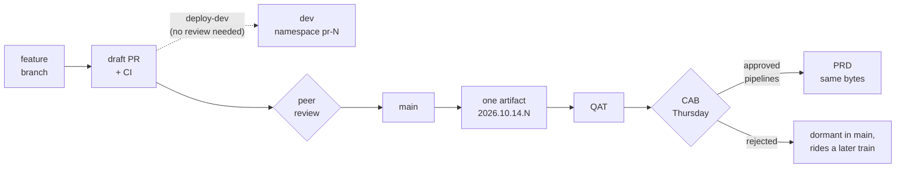

# dataops — Spark 4 data engineering monorepo

Dev environment: **Spark 4.1.3**, **Python 3.12**, **Java 17**, all defined in `.devcontainer/Dockerfile`.

## Layout
```
.devcontainer/        Dockerfile + devcontainer.json
libs/common/          shared Spark session factory, transforms (importable by every pipeline)
src/pipelines/<area>/<etl>/   one package `pipelines`; jobs grouped by subject area
tests/<area>/         tests mirroring src/pipelines
data/                 local raw/processed data (processed is git-ignored)
```
The root project is the single `pipelines` package; it is also a [uv workspace](https://docs.astral.sh/uv/concepts/projects/workspaces/) whose members are the dirs under `libs/*`.

## Use
Open in VS Code → "Reopen in Container", then:
```
make test           # all tests
make run-example    # run pipelines.examples.example_etl
make lint
```
Spark UI on :4040 while a job runs.

## Add a pipeline
Create `src/pipelines/<area>/<etl>/` (with `__init__.py` and `job.py`) and a test under `tests/<area>/`. Run with `python -m pipelines.<area>.<etl>.job`.

## Development and release flow

One artifact is built on merge to `main` and the **same bytes** are promoted to QAT and
then production. Environments differ only by injected config, never by code.



| Stage | Trigger | Gate |
|---|---|---|
| dev | manual, from your branch | PR checks only |
| QAT | automatic on merge to `main` | none |
| release candidate | Monday 14:00 UTC | frozen; QA validates Mon–Wed |
| production | manual, after CAB | `prd` environment approval |

- **[docs/workflow-diagrams.md](docs/workflow-diagrams.md)** — five diagrams: the full path,
  weekly cadence, blast radius, a four-developer day, and selective deployment
- **[docs/release-process.md](docs/release-process.md)** — the written process, CAB
  rejection ladder, and release-branch rules
- `./tools/simulate-release.sh` — replay a full release locally in a throwaway clone
