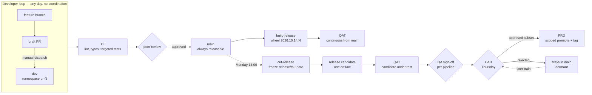
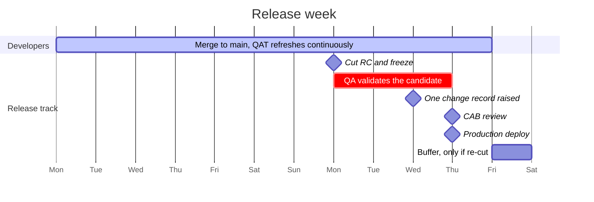
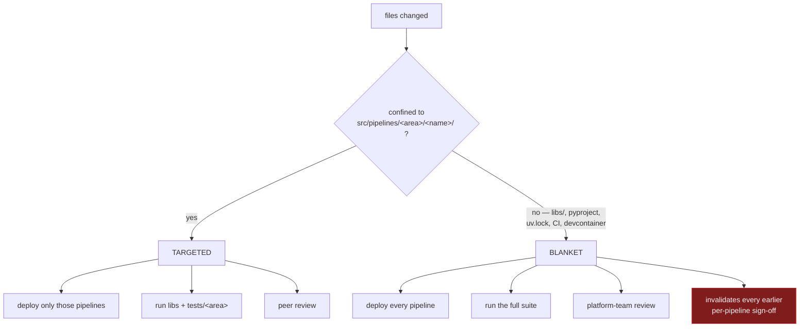
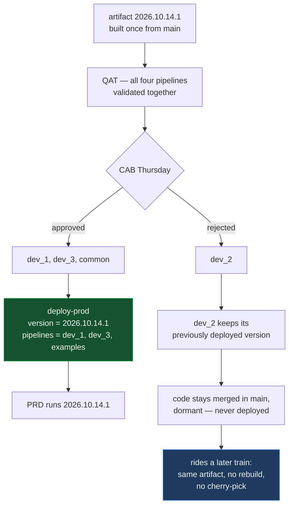
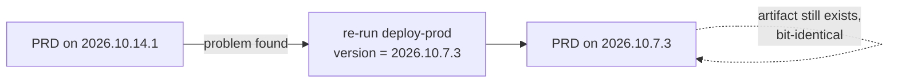

# Development and release flow

Five views of the same process, each answering one question. GitHub renders these
diagrams inline; VS Code previews them with the Markdown preview pane.

Prose details live in [release-process.md](release-process.md).

---

## 1. The whole path, start to finish

One artifact is built on merge to `main` and the **same bytes** are promoted onward.
Nothing after the build ever recompiles from source.



The two QAT boxes are the same environment. It tracks `main` continuously so problems
surface hours after merging, and holds the frozen candidate during release week.

---

## 2. Weekly cadence

Developers work on their own schedule. Only the release track is dated.



A change merged Tuesday waits for the following Monday's cut and ships about nine days
later. That is the cost of weekly CAB, not a limitation of the pipeline.

---

## 3. Blast radius — one rule, used everywhere

Computed once in [`affected.py`](../.github/scripts/affected.py). It drives how much gets
tested, how much gets deployed, and (via `CODEOWNERS`) who must review.



`B4` is the one most hand-rolled processes miss: a shared change landing **last** silently
staled every sign-off that came before it. `deploy-qat.yml` re-runs everything when it
sees `blanket=true`.

---

## 4. A real day: four developers, staggered merges

```mermaid
sequenceDiagram
    autonumber
    participant D as Developers
    participant M as main
    participant Q as QAT
    participant R as Release manager
    participant P as PRD

    Note over D,Q: 10/14 — each merge refreshes QAT within minutes
    D->>M: 09:00  dev_2 merges
    M->>Q: deploy — TARGETED
    D->>M: 10:00  dev_1 merges
    M->>Q: deploy — TARGETED
    D->>M: 13:00  dev_3 merges
    M->>Q: deploy — TARGETED
    D->>M: 16:00  dev_4 merges libs/
    M->>Q: deploy — BLANKET
    Note over Q: full suite re-runs;<br/>dev_1 and dev_3 sign-offs refreshed<br/>against the final combined state

    R->>R: Mon — cut RC, freeze, build once
    Q->>R: QA signs off per pipeline
    R->>P: Thu after CAB — promote approved subset
    Note over P: same bytes QA validated
```

Every developer still gets same-day feedback. Nobody waits for a QAT slot, because QAT is
never a resource one PR holds.

---

## 5. One artifact, selective deployment

How CAB rejects a single item without anyone cherry-picking.



The approved list scopes **what gets deployed**, never what gets built. That is the whole
difference between this and assembling code on release day — the artifact promoted to
production is byte-identical to the one QA tested.

Per-pipeline `common==<version>` pinning is what makes the exclusion real: `dev_2` keeps
running against its old shared code rather than silently picking up the new one.

---

## Rollback



Code rollback is a single workflow re-run. **Data is not** — a pipeline that already
overwrote good output with bad is not recovered by redeploying code. Partition writes and
validate to a staging path before publishing.
