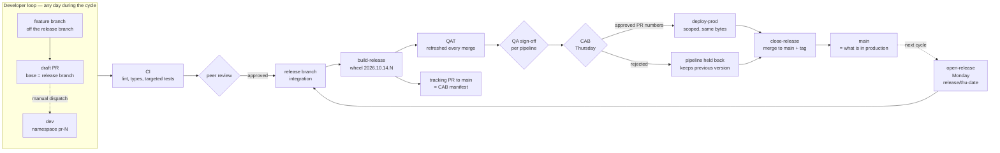
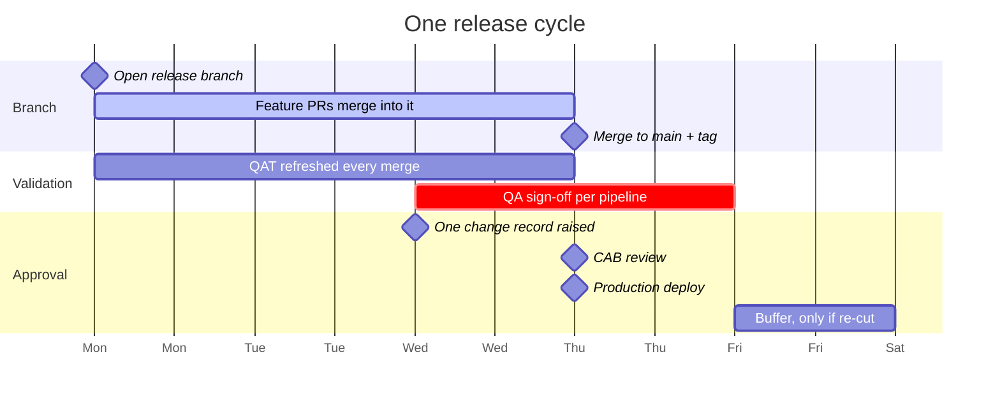
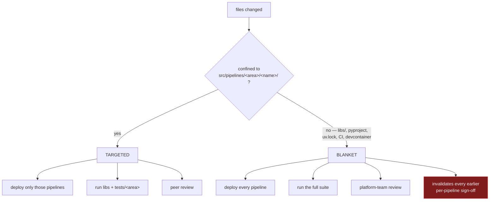
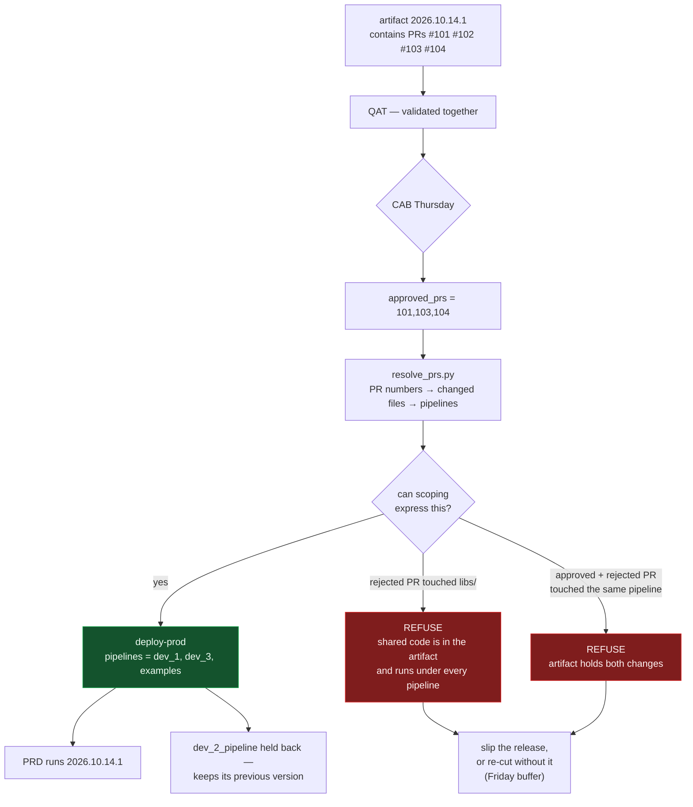
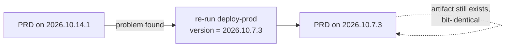

# Development and release flow

Five views of the same process, each answering one question. GitHub renders these
diagrams inline; VS Code previews them with the Markdown preview pane.

Prose details live in [release-process.md](release-process.md).

---

## 1. The whole path, start to finish

Feature work merges into the **release branch**. `main` receives only a completed,
CAB-approved release, so `main` records what is in production. One artifact is built per
merge, and the **same bytes** are promoted onward — nothing after the build recompiles.



Only **one** release branch is open at a time. `open-release` refuses to create a second
one, because two open releases diverge and you resolve that by hand.

Held-back code still merges to `main` as part of the release — dormant, never deployed,
and eligible for the next release with no cherry-picking.

---

## 2. Weekly cadence

Developers work on their own schedule. Only the release track is dated.



Work that misses the cycle waits for the next release branch. Because `main` only moves
at the end, the next cycle's branch must be opened **after** the previous one merges —
`open-release` enforces this by refusing to create a second open release branch.

---

## 3. Blast radius — one rule, used everywhere

Computed once in [`affected.py`](../.github/scripts/affected.py). It drives how much gets
tested, how much gets deployed, and (via `CODEOWNERS`) who must review.



`B4` is the one most hand-rolled processes miss: a shared change landing **last** silently
staled every sign-off that came before it. `deploy-qat.yml` re-runs everything when it
sees `blanket=true`.

---

## 4. A real day: four developers, staggered merges

```mermaid
sequenceDiagram
    autonumber
    participant D as Developers
    participant R as release/2026-10-16
    participant Q as QAT
    participant C as CAB
    participant P as PRD
    participant M as main

    Note over R: 10/12 — open-release creates the branch from main

    Note over D,Q: 10/14 — each merge rebuilds the candidate and refreshes QAT
    D->>R: 09:00  PR #102 dev_2 merges
    R->>Q: deploy — TARGETED
    D->>R: 10:00  PR #101 dev_1 merges
    R->>Q: deploy — TARGETED
    D->>R: 13:00  PR #103 dev_3 merges
    R->>Q: deploy — TARGETED
    D->>R: 16:00  PR #104 dev_4 merges libs/
    R->>Q: deploy — BLANKET
    Note over Q: full suite re-runs;<br/>#101 and #103 sign-offs refreshed<br/>against the final combined state

    Q->>C: 10/15 QA signs off per pipeline
    Note over C: approves #101 #103 #104<br/>rejects #102
    C->>P: 10/16 deploy-prod approved_prs=101,103,104
    Note over P: dev_2_pipeline held back,<br/>keeps its previous version
    P->>M: close-release — merge + tag v2026.10.14.1
    Note over M: #102's code is in main,<br/>dormant, rides the next release
```

Every developer still gets same-day feedback. Nobody waits for a QAT slot, because QAT is
never a resource one PR holds.

Note step 8: dev_4's shared change lands **last**, which stales the sign-offs from steps
4 and 6. The blanket revalidation is what makes staggered per-PR testing safe.

---

## 5. Approved PR numbers to a deployed pipeline set

You hand `deploy-prod` the PR numbers CAB approved. It resolves them to pipelines and
scopes the deploy — no cherry-picking, no rebuild.



The approved list scopes **what gets deployed**, never what gets built. That is the whole
difference between this and assembling code on release day — the artifact promoted to
production is byte-identical to the one QA tested.

Per-pipeline `common==<version>` pinning is what makes a held-back pipeline real: `dev_2`
keeps running against its old shared code instead of silently picking up the new one.

The two red paths are not pessimism — they are the cases where "deploy only the approved
PRs" is not a thing that can be done without building something nobody tested. The
workflow stops instead of pretending.

---

## Rollback



Code rollback is a single workflow re-run. **Data is not** — a pipeline that already
overwrote good output with bad is not recovered by redeploying code. Partition writes and
validate to a staging path before publishing.
